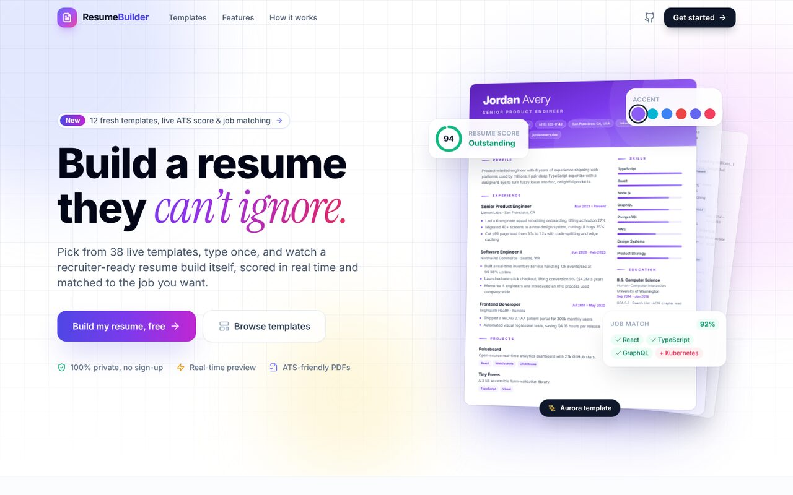
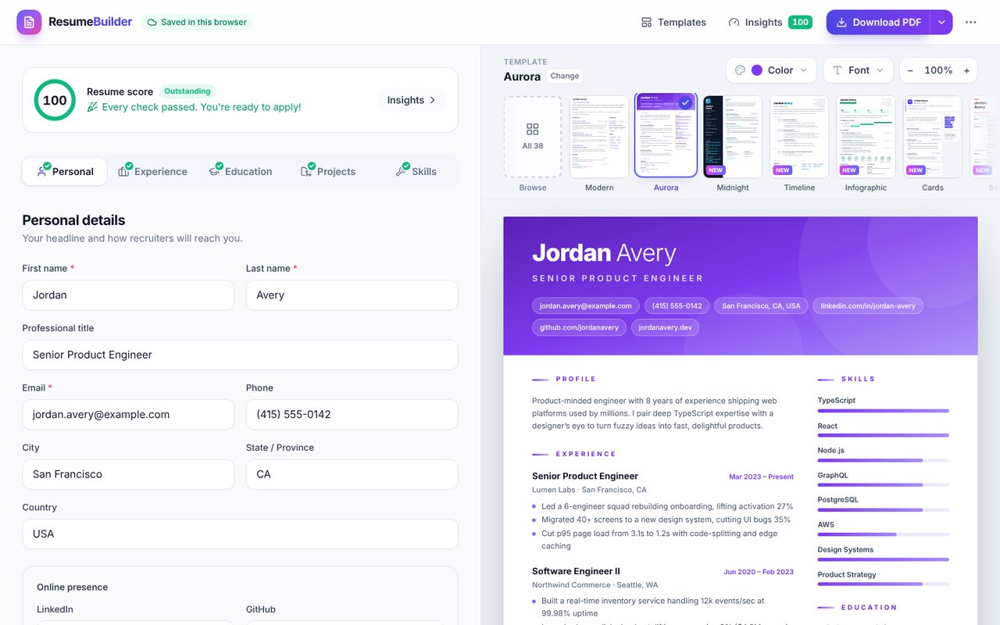
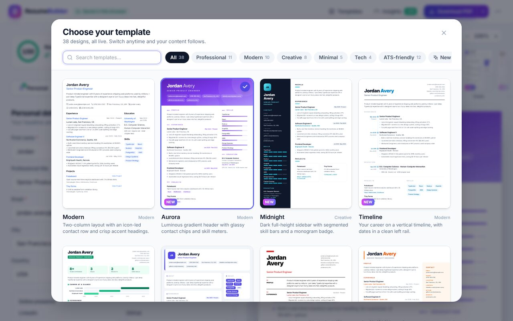
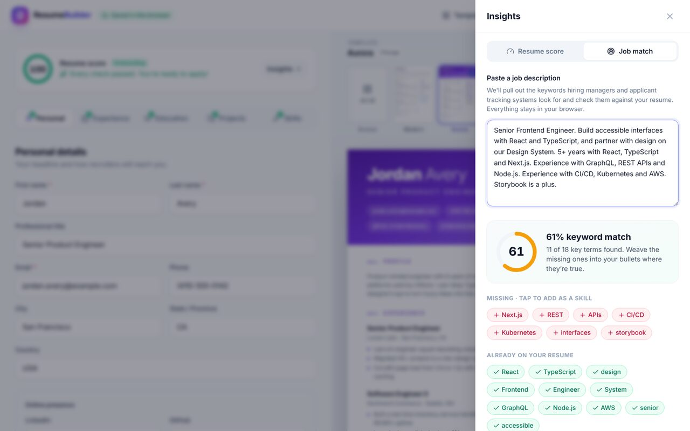

# Resume Builder

**Build a resume they can't ignore.** Pick from 38 live templates, type once, and watch a recruiter-ready resume build itself, scored in real time and matched to the job you want. Free, private, and no sign-up: everything runs in your browser.

**[Try it live →](https://soham-tarabada.github.io/resume-builder/)**



## Highlights

| | |
|---|---|
| **38 live templates** | From ATS-safe classics (Ivy, Compact, Standard) to bold creative layouts (Aurora, Midnight, Infographic, Editorial). Every thumbnail is a real render, not a stock photo. |
| **Design studio** | 12 accent colors × 10 typefaces that work across every template, plus a "template default" option. |
| **Resume score** | A live 0–100 score built from 12 checks based on common recruiter advice (quantified results, action verbs, summary length…). Each tip links to the section that fixes it. |
| **Job match** | Paste a job description to see which keywords your resume already covers. Add missing ones as skills in one tap. |
| **WYSIWYG A4 preview** | The preview renders at true A4 width and scales to fit, so what you see is exactly what you download. Dashed markers show page breaks. |
| **Export your way** | Instant PDF download, print-to-PDF with selectable text for ATS uploads, plain text for application forms, and JSON backup/restore. |
| **Private by design** | No account, no backend, no analytics. Your resume autosaves to your own browser's local storage. |



<table>
  <tr>
    <td></td>
    <td></td>
  </tr>
</table>

### Thoughtful details

- Bullet helper: press Enter in an achievements box to continue the bullet list.
- Undo for deleted entries, imports, "load example" and "start over".
- Reorder jobs, education and projects; paste a comma-separated list to add many skills at once.
- Delightful extras: a 3D hero that follows your cursor, a live typing demo, a template marquee, and confetti in your resume's own accent color when you download.
- Works on phones (Edit / Preview switcher) and respects `prefers-reduced-motion`.

## Tech stack

React 18 · TypeScript · Tailwind CSS · Vite · lucide-react · html2pdf.js (lazy-loaded on first export)

## Getting started

```sh
npm install
npm run dev       # start the dev server
npm run build     # production build
npm run preview   # preview the production build
npm run lint      # lint
```

## Project structure

```
src/
├── App.tsx                     # Hash router: landing (#/) and builder (#/builder)
├── components/
│   ├── landing/                # Landing page: hero showcase, marquee, feature bento
│   ├── builder/                # Builder shell: header, template strip & gallery,
│   │                           #   design controls, insights drawer, print portal
│   ├── form/                   # Editor sections (personal, experience, education…)
│   ├── preview/
│   │   ├── ResumeDocument.tsx  # A4 page that applies accent + font as CSS variables
│   │   ├── ScaledPage.tsx      # Fits an A4 page into any container
│   │   ├── TemplateThumbnail.tsx
│   │   └── templates/          # 38 template components
│   └── ui/                     # Form fields, toasts, score ring, cards…
├── context/                    # Resume state, persistence and migration
├── data/                       # Template registry, palettes, fonts, sample resume
├── hooks/
└── utils/                      # Date formatting, scoring, keyword matching, exporters
```

### Adding a template

1. Create `src/components/preview/templates/MyTemplate.tsx`. Read data with `useResume()` and format with the helpers in `src/utils/format.ts`.
2. Use `accent-*` Tailwind colors (`text-accent-600`, `bg-accent-50`…) for anything that should follow the user's color choice. For SVG fills and strokes, use `useAccentHex()` so colors survive PDF export.
3. Register it in `src/data/resumeTemplates.ts` with a category, description and default accent.

The resume is always laid out at A4 width (794px), so don't use viewport breakpoints (`sm:`, `md:`…) inside templates.

## Deployment

The app deploys to GitHub Pages (see `homepage` in `package.json` and `base` in `vite.config.ts`):

```sh
npm run deploy
```

## License

This project is licensed under the MIT License.
